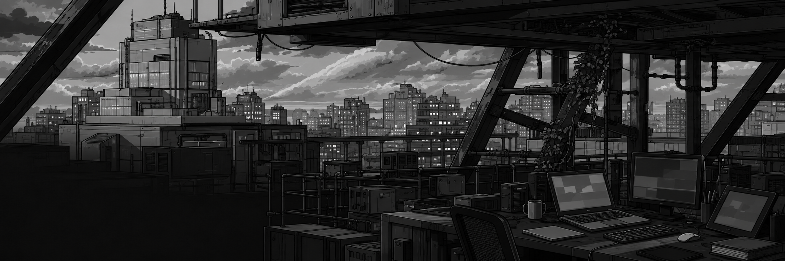
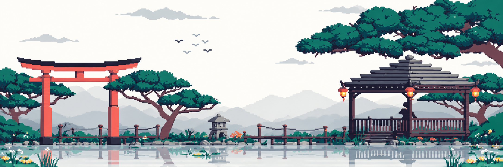

  

<h1 align="center">Hi there 👋</h1>

  Cybersecurity &nbsp;·&nbsp; Web design &nbsp;·&nbsp; Web development

---

### About me

- 🛡️ I'm developing my skills in **cybersecurity**.
- 🎨 I'm a **web designer** building strong design foundations.
- 💻 I build **websites from scratch**, including **P2P marketplaces** and websites for the **fashion industry**.

### Languages & tools

  
  
  
  
  
  
    
  
  
  
  
  

  Bash · Python · Go · C++ · Linux · HTML · CSS · JavaScript · Figma · Git · VS Code

---

  

